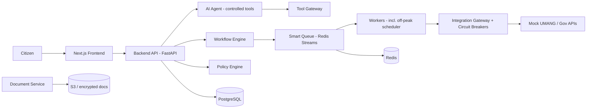

# GovFlow — Architecture & Design Proposal

> ### ⚠️ STATUS: DESIGN DOCUMENT — NO IMPLEMENTATION
>
> This repository contains **architecture documentation and an empty directory
> skeleton only**. Phase 1 of 21 is complete. **Zero lines of application code
> have been written.** Every directory under `backend/`, `frontend/`, `worker/`,
> `ai-agent/`, `document-service/`, `infrastructure/`, `mock-government/`,
> `jenkins/`, `scripts/`, `tests/`, `terraform/` and `kubernetes/` contains
> nothing but a zero-byte `.gitkeep` placeholder.
>
> There is **no `docker-compose.yml`, no `Jenkinsfile`, no `package.json`, no
> `pyproject.toml`, no `requirements.txt`, no Dockerfile, no Terraform `.tf`
> file, and no Kubernetes manifest** in this repository.
>
> Published as a **design and architecture portfolio artifact** — "here is how I
> would design this system" — not as a working product.

> **"One interface. Decentralized trust. Intelligent infrastructure."**
>
> GovFlow — *Proposed intelligent infrastructure layer for UMANG.*
> This is a **concept**. GovFlow is **not** an official government product and is **not** affiliated with NeGD/MeitY or UMANG. It connects **only to mock government APIs** with synthetic data. No production system, no government credentials, no real citizen identity data.

---

## 1. What is GovFlow?

GovFlow is a proposed **AI-powered orchestration and resilience layer** that sits *in front of* (not instead of) the UMANG ecosystem. It demonstrates two theses:

| # | Thesis | Proof in MVP |
|---|--------|--------------|
| **A** | A citizen with limited digital literacy can complete a government-service application using **conversational AI** — no middleman/agent needed. | Hindi/English/Marathi chat + voice → service discovery → simulated DigiLocker fetch → document intelligence → AI-drafted form → **explicit citizen confirmation** → submission. |
| **B** | GovFlow can **absorb a major traffic spike**, protect fragile government backends, queue work durably, and process non-urgent work in **off-peak windows**. | Traffic spike simulation (10K→150K req/s), circuit breakers, smart queues (realtime/standard/priority/deferred/tatkal), off-peak scheduler, load balancing across Central DC / State DC / AWS. |

## 2. Why UMANG? The problem

- Government backends experience **extreme peaks** and long idle periods; outages block citizens entirely.
- Complex forms + English-only UX force citizens toward **paid intermediaries**.
- No intelligent buffering layer exists between citizen traffic and departmental systems.

## 3. The solution

An AI assistant that *understands* (never *decides*), a deterministic workflow + policy engine that *controls*, and a queueing/shielding layer that *protects*. The **AI assists; the workflow engine governs; the citizen confirms.**



## 4. Design scope

**Services (exactly 3, registry-driven):** Income Certificate · Birth Certificate · Driving Licence
**Languages:** English · Hindi · Marathi (text + voice UI)
**Key subsystems (designed, not built):** AI agent (9 whitelisted tools), service registry (versioned, DB-backed), workflow engine, policy engine (ALLOW/DENY/REQUIRE_CONFIRMATION/REQUIRE_STEP_UP/QUEUE), human-in-the-loop confirmation, smart queues + off-peak scheduler, tatkal with daily caps, circuit breakers, infrastructure simulator (Central DC / State DC / AWS), security dashboard with attack simulations (prompt injection, API flood, malicious document, compromised service, failed auth), audit hash-chain, demo mode.

## 5. Monorepo layout

**Intended** layout, with the current state of each path. Every entry marked
*empty* contains only a zero-byte `.gitkeep`.

```
govflow/
├── frontend/            *empty*  Next.js (App Router) + TypeScript strict + Tailwind
├── backend/             *empty*  FastAPI BFF + workflow/policy/integration/audit modules
│   └── app/{api,core,models,schemas,services,repositories,workflows,policies,
│            agents,documents,queues,integrations,security,audit,monitoring}
├── ai-agent/            *empty*  Controlled LLM agent + tool gateway (FastAPI)
├── document-service/    *empty*  Upload validation, malware scan, OCR sandbox, extraction
├── worker/              *empty*  Queue consumers, submission, off-peak scheduler
├── mock-government/     *empty*  Mock UMANG/state APIs with fault injection + admin controls
├── infrastructure/      *empty*  Compose configs, Prometheus/Grafana, local dev assets
├── terraform/           *empty*  modules/{networking,eks,rds,redis,s3,ecr,iam,monitoring,waf}
│                                 environments/{dev,staging,production}
├── kubernetes/          *empty*  namespaces, deployments, services, ingress, hpa, pdb,
│                                 network-policies, configmaps, secrets, jobs
├── jenkins/             *empty*  Pipeline support files (shared lib, scan configs)
├── scripts/             *empty*  Dev/bootstrap/utility scripts
├── tests/               *empty*  Cross-cutting: load (k6), integration, security
├── docs/                        ← the actual content of this repository
├── .env.example                 ← variable names only, all values empty
└── README.md
```

**Not present:** `docker-compose.yml` and `Jenkinsfile` are described in the
design but do **not** exist in this repository. Neither does any build manifest
of any kind.

## 6. Local development

**There is nothing to run.** This is a documentation repository and the
application has not been written. `docker compose up` — described in the design
as the one-command local stack — cannot work, because no `docker-compose.yml`
exists here and none of the services it would start are implemented.

The only configuration artifact is `.env.example`, which lists variable **names**
with every value empty. A sibling repository,
[`govflow-architecture-draft`](https://github.com/), contains a
`docker-compose.yml` for PostgreSQL and Redis; it is an earlier, shorter draft
of this same design and its specification differs in several places.

### Configuration reference

| Group | Variables |
| --- | --- |
| Core | `GOVFLOW_ENV`, `SECRET_KEY`, `CORS_ORIGINS` |
| Data stores | `POSTGRES_USER`, `POSTGRES_PASSWORD`, `POSTGRES_DB`, `DATABASE_URL`, `REDIS_URL` |
| Object storage | `S3_ENDPOINT`, `S3_BUCKET`, `S3_ACCESS_KEY`, `S3_SECRET_KEY` |
| AI provider | `LLM_PROVIDER` (`mock` \| `openai-compatible`), `LLM_BASE_URL`, `LLM_API_KEY`, `LLM_MODEL` |
| Document pipeline | `MAX_UPLOAD_MB`, `DOC_RETENTION_DAYS` |
| Simulator | `SIM_TATKAL_DAILY_CAPACITY`, `DEFERRED_WINDOW_START` |

`SECRET_KEY`, `DATABASE_URL` and all four S3/LLM credentials are **empty by
design**. Generate real secrets locally rather than copying defaults. No AWS
account, no API key and no Docker is required to read this repository.

## 6a. Testing and building

**There is no test suite and there is nothing to build.** The development plan
defines exit criteria for 21 phases, but Phase 1 is a documentation phase and no
test has been executed. The planned matrix — pytest, vitest, Playwright, k6 load
tests and a security suite — is specified in
[docs/development-plan.md](docs/development-plan.md) and
[docs/threat-model.md](docs/threat-model.md).

## 7. Documentation

| Document | Purpose |
|---|---|
| [docs/architecture.md](docs/architecture.md) | Complete technical architecture |
| [docs/threat-model.md](docs/threat-model.md) | STRIDE + AI threat analysis |
| [docs/development-plan.md](docs/development-plan.md) | 21-phase build plan with exit criteria |
| [docs/database-erd.md](docs/database-erd.md) | PostgreSQL ERD + data-minimization rules |
| [docs/api-contract.md](docs/api-contract.md) | REST/SSE API contract (v1) |
| [docs/service-workflows.md](docs/service-workflows.md) | Registry + workflows for the 3 MVP services |
| [docs/terraform-architecture.md](docs/terraform-architecture.md) | AWS IaC plan (VPC, EKS, RDS, ElastiCache, WAF…) |
| [docs/kubernetes-architecture.md](docs/kubernetes-architecture.md) | EKS workload architecture |
| [docs/jenkins-cicd-architecture.md](docs/jenkins-cicd-architecture.md) | CI/CD pipeline + security scanning |
| [docs/dependencies-and-risks.md](docs/dependencies-and-risks.md) | Dependency & risk register |
| [docs/demo-script.md](docs/demo-script.md) | End-to-end demo story + demo-mode controls |

## 8. Non-negotiable engineering rules (abridged)

1. Never connect to production government APIs; never use real credentials.
2. Never store real Aadhaar/PAN or sensitive identity data — synthetic data only.
3. AI may **never** submit consequential applications without explicit citizen confirmation.
4. Document contents are **untrusted data**, never instructions.
5. Never silently drop queue messages; idempotency keys on all consequential operations.
6. No secrets in code, images, or git; no public databases.
7. AI output is untrusted until schema-validated.

## 9. Status & roadmap

**Current status:** Phase 1 of 21 — architecture, threat model, and development plan complete. **No implementation exists.** Work proceeds per [docs/development-plan.md](docs/development-plan.md).

Design decisions are recorded as ADRs 001–007 in
[docs/architecture.md](docs/architecture.md), including a Redis SSPL/RSAL
licensing analysis that recommends a Valkey-compatible client.

Roadmap after MVP: real DigiLocker adapter, OIDC/passkey auth, additional services via registry (no AI changes), multi-region active-active, formal accessibility audit (WCAG 2.2 AA), chaos testing.

## 10. Relationship to the sibling repository

This is one of **two independent Phase 1 authoring passes** at the same design,
written about 22 hours apart. This copy (2026-08-24) is the longer revision, with
a substantially larger threat model, the ADR table, rate-limit tables, WCAG 2.2
AA accessibility gates, and a three-times-longer development plan. The sibling
`govflow-architecture-draft` repository (2026-08-23) is a shorter, faster draft
and is the only one that contains a `docker-compose.yml`.

**The two are not byte-copies and their specifications disagree** — on session
cookie name (`gf_session` vs `gv_session`), mock-government port (8003 vs 9000),
health endpoint paths (`/healthz`, `/readyz` vs `/health/live`, `/health/ready`),
SSE paths, error codes, Terraform version constraints, and the submission
confirmation flow (this copy uses a two-step token bound to the payload's
SHA-256, which is the stronger design). Neither is a superset of the other.

Treat each repository as a standalone snapshot rather than a coherent
specification.

## 11. License & disclaimer

Concept/design project for evaluation. Not affiliated with, endorsed by, or
connected to any government body. All data shown is simulated.
