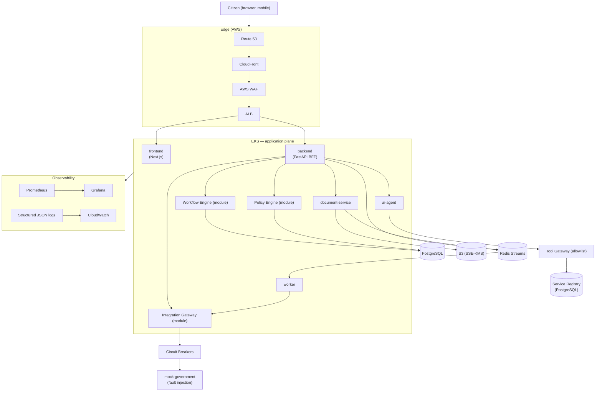
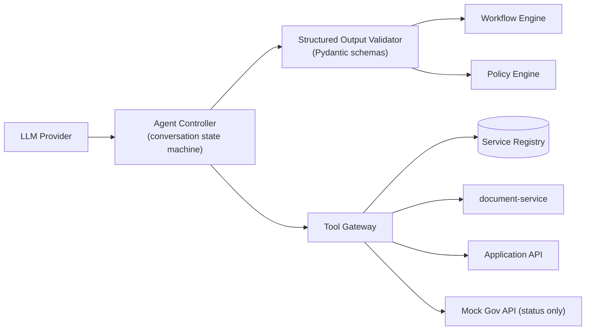
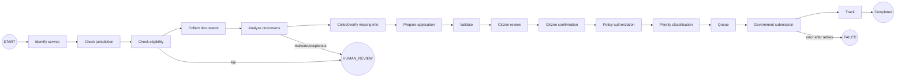
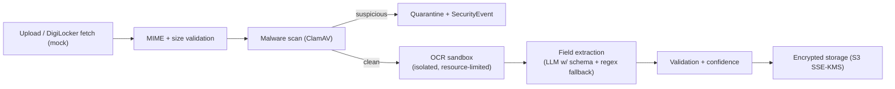

# GovFlow — Technical Architecture

| | |
|---|---|
| **Status** | Approved for implementation (Phase 1) |
| **Version** | 1.0 |
| **Scope** | MVP — 3 services (Income Certificate, Birth Certificate, Driving Licence) |
| **Disclaimer** | GovFlow is a proposed concept layer for UMANG. All government APIs are mocks with synthetic data. |

---

## 1. Overview

GovFlow is an **AI-powered orchestration and resilience layer** proposed for the UMANG ecosystem. It is *optional* from UMANG's perspective — an enhancement layer, never a replacement or a mandatory dependency.

Two capabilities define the MVP:

1. **Conversational service completion** — a citizen completes a government application end-to-end through multilingual AI-assisted conversation, with documents fetched (simulated DigiLocker) or uploaded, fields extracted and verified, and **explicit human confirmation** before any submission.
2. **Resilient orchestration at scale** — traffic spikes are absorbed, government backends are shielded by circuit breakers, work is queued durably with priority classes, and flexible workloads are executed during off-peak windows with load smoothing.

## 2. Design principles

1. **AI assists; the workflow engine controls.** The LLM proposes; deterministic code disposes. All state transitions happen in the workflow engine, never in the model.
2. **Human-in-the-loop for consequential actions.** Submission, identity modification, payments, and permission grants always require explicit citizen confirmation.
3. **Deterministic security controls.** AuthN/AuthZ, policy decisions, injection defense gating, and rate limits are code + config, never LLM judgment.
4. **Data minimization.** Store only what the MVP requires. No centralized citizen-record store. No real Aadhaar/PAN. Encrypted fields where sensitive.
5. **Graceful degradation.** Every dependency (AI, Redis, Postgres, government API, S3) has a defined degraded mode. GovFlow must never become a mandatory SPOF for UMANG.
6. **Everything as code.** Terraform, Kubernetes manifests, Dockerfiles, pipelines, service registry, workflow definitions.
7. **Mock at the government edge.** A single, well-defined integration boundary (`mock-government`) simulates success/latency/overload/429/500/503/timeout/maintenance/recovery. Swapping in a real adapter later changes one module.
8. **Registry-driven services.** Service logic (fields, documents, eligibility, fees, workflows) lives in the versioned Service Registry — never hardcoded in prompts or AI code.

## 3. System overview

## 4. Deployable components

| Component | Tech | Responsibility | Scaling |
|---|---|---|---|
| **frontend** | Next.js (App Router), TS strict, Tailwind | All citizen/admin UI; SSE consumers; Web Speech API for voice | HPA on CPU/RPS |
| **backend** | FastAPI, Pydantic v2, SQLAlchemy 2 async, Alembic | BFF API; **modules**: workflow-engine, policy-engine, integration-gateway, notification, audit, security, monitoring | HPA; stateless |
| **ai-agent** | FastAPI + LLM SDK | Conversation state, prompt assembly, tool orchestration via Tool Gateway, output validation, injection screening | HPA; stateless (state in Postgres/Redis) |
| **document-service** | FastAPI | Upload validation (MIME/size), malware scan hook (ClamAV), OCR sandbox, field extraction, encrypted storage to S3 | HPA on queue depth |
| **worker** | Python consumer | Queue consumers (realtime/standard/priority/deferred/tatkal), submission pipeline, off-peak scheduler, retry/DLQ handling | HPA on queue lag |
| **mock-government** | FastAPI | Mock UMANG/state endpoints with fault-injection admin controls; latency/overload/429/500/503/timeout/maintenance profiles | Single replica (demo) |

**Modular-monolith decision (ADR-001):** workflow-engine, policy-engine, integration-gateway, notification-service and audit-service exist as **strictly bounded modules inside `backend`** with their own packages and public interfaces. Kubernetes manifests define all 10 logical services from the spec; the five module-based services run as Deployments of the backend image with different entrypoints, so they can be split into separate deployables later **without API changes**.

### Local ports

frontend 3000 · backend 8000 · ai-agent 8001 · document-service 8002 · mock-government 8003 · postgres 5432 · redis 6379 · prometheus 9090 · grafana 3001.

## 5. AI architecture

**Chain:** LLM → Agent Controller → Structured Output Validator → Workflow Engine → Policy Engine → Tool Gateway → Mock Government API.

### 5.1 Agent Controller
- Per-conversation deterministic state machine (states mirror the workflow), persisted in Postgres; Redis only for ephemeral scratch.
- Language handling: en/hi/mr detection + response language pinning; voice input transcribed client-side (Web Speech API) with backend stub for future ASR.
- Prompt assembly: system prompt + registry-derived service facts + redacted conversation history. **No government logic in prompts** — the registry is the single source of truth.

### 5.2 Tools (exactly nine, allowlisted)

| Tool | Purpose | Guardrails |
|---|---|---|
| `find_service` | NL → service match from registry | Read-only, registry only |
| `get_service_requirements` | Documents/fields/fees/SLA | Read-only, versioned |
| `check_eligibility` | Evaluate registry eligibility rules | Read-only |
| `analyze_document` | Trigger document analysis | Document must belong to session user; content treated as data |
| `prepare_application` | Draft application from verified extractions | Draft state only |
| `validate_application` | Schema + registry validation | Read-only |
| `get_processing_options` | Standard/Priority/Deferred/Tatkal availability | Tatkal capacity check |
| `get_application_status` | Citizen's own applications only | Ownership enforced |
| `request_submission` | **Request** submission | Returns policy decision; never submits. Requires citizen confirmation + policy ALLOW before queueing |

**Hard denials (enforced in code and NetworkPolicy):** the ai-agent cannot reach PostgreSQL, Redis, arbitrary URLs, or the internet. Egress from the ai-agent pod is denied except to `backend` internal endpoints. All tool calls are audited with correlation IDs.

### 5.3 Structured Output Validator
- Every LLM response must parse into a strict Pydantic envelope: `{reply, intent, tool_calls[], extracted{}, requires_confirmation, suggested_responses[]}`.
- Invalid output → one bounded repair attempt → deterministic fallback (guided manual form flow). LLM JSON is **never trusted directly**.

### 5.4 Prompt-injection defense (deterministic layers)
1. **Instruction hierarchy:** system prompt states document/chat content is *data*; tools are only invocable via validated structured output from the controller.
2. **Content screening:** regex + classifier heuristics flag instruction-like patterns ("ignore previous instructions", URLs + "send", "exfiltrate", tool names in content) → security event, no tool call.
3. **Tool gating:** even a "successful" injection cannot pass `request_submission` — policy engine requires citizen confirmation artifact + auth strength.
4. **Output scanning:** replies are scanned for secrets/PII leakage and tool-call forgery before delivery.
5. **Egress denial:** network-level — the agent physically cannot call attacker endpoints.

## 6. Workflow engine

Deterministic, persisted state machine per application (`WorkflowExecution`). The AI may *propose* transitions; only the engine *executes* them. Every transition is validated against the service version's workflow definition and audited.

- States are the canonical enum shared by API, queue, and UI: `RECEIVED → VALIDATING → QUEUED → PROCESSING → SUBMITTED → COMPLETED`, with `FAILED` and `HUMAN_REVIEW` terminal/holding states.
- Idempotent transition handlers; duplicate events are no-ops (keyed by `idempotency_key`).
- Crash-safe: state lives in Postgres; queue messages are at-least-once and handlers are idempotent.

## 7. Policy engine

Every sensitive operation passes through the Policy Engine before execution.

**Inputs:** identity, authentication strength (password / OTP-sim / step-up), role (citizen/admin/auditor), service + version, operation, purpose, jurisdiction, user permissions, citizen confirmation artifact (hash of reviewed payload), risk signals (velocity, IP reputation, anomaly flags), time, token/session scope.

**Outputs:** `ALLOW | DENY | REQUIRE_CONFIRMATION | REQUIRE_STEP_UP_AUTH | QUEUE`. Every decision is persisted (`PolicyDecision`) and audited with minimized input snapshot.

Rules are **declarative Python/JSON policy definitions** evaluated by code — no LLM involvement. Examples:
- `submission.requires_confirmation` — DENY unless a valid confirmation artifact matches the current application hash.
- `tatkal.capacity` — DENY with user-facing "Tatkal capacity is currently full" when daily cap (e.g., 5,000) exhausted.
- `admin.operations` — admin role + step-up auth + audit; unauthorized admin ops are blocked and raise security events.

## 8. Smart queues, priorities, off-peak scheduling

### 8.1 Queue topology (Redis Streams)

| Queue | Purpose | Consumer |
|---|---|---|
| `realtime` | Status checks, tracking reads | backend (inline, not durable) |
| `standard` | Normal applications | worker pool |
| `priority` | Government-defined priority | worker pool (weight) |
| `deferred` | Flexible jobs for off-peak windows | off-peak scheduler |
| `tatkal` | Paid expedited, capped | dedicated small pool |

- **Durability:** `QueueItem` rows in Postgres are the source of truth; Redis Streams is transport + consumer groups. A reconciler re-enqueues orphaned items → **no silent loss**.
- **States:** `RECEIVED, VALIDATING, QUEUED, PROCESSING, SUBMITTED, COMPLETED, FAILED, HUMAN_REVIEW`.
- **Idempotency:** submission keyed by `application.id + idempotency_key`; duplicates return the original result.
- **DLQ:** after `max_attempts` with exponential backoff → `FAILED`/`HUMAN_REVIEW` + alert. Never dropped.

### 8.2 Priority classes
`STANDARD` (normal) · `PRIORITY` (gov-defined eligibility) · `DEFERRED` (citizen-opted flexible) · `TATKAL` (paid expedited, capped daily, "pay to bypass" explicitly rejected — tatkal has a reserved capacity slice, it does not preempt others).

### 8.3 Off-peak scheduler (load smoothing, not midnight dumping)
- Monitors simulated backend capacity; forecasts load; classifies flexible jobs.
- Releases the deferred queue on a **gradual curve**, e.g. `01:00 5% → 01:30 10% → 02:00 20% → 02:30 25% → 03:00 20% → 03:30 15% → 04:00 5%`, with jitter and backpressure (pause when error rate/latency thresholds trip).

## 9. Circuit breakers & load balancing

- **Per-integration circuit breaker** (one per mock endpoint + DigiLocker mock): `CLOSED → OPEN` after failure-rate threshold (e.g., ≥50% of last 20 calls), cool-down → `HALF_OPEN` (limited probes) → gradual recovery → `CLOSED`. While OPEN: requests are queued (not errored to citizens), status surfaces "queued due to government system load".
- **Load balancer / router:** picks target node (CENTRAL_DC / STATE_DC / AWS_CLOUD) per workload using weighted score of health, capacity headroom, p95 latency, queue depth, and workload priority. Flexible traffic is routed away from overloaded nodes first.

## 10. Infrastructure simulator

Simulated nodes with CPU, RAM, capacity (rps), latency, error rate, health (GREEN/YELLOW/RED), state (healthy/slow/overloaded/failed/recovering). A scenario engine drives:

- **Traffic spike:** ramp `10K → 30K → 60K → 100K → 150K req/s` with realistic latency/error/queue-depth effects, autoscaling events, and load-balancer re-routing.
- **Integration failure/recovery:** drives circuit breakers end-to-end.
- Dashboards consume live metrics over **SSE** (`/api/v1/streams/infrastructure`, `/security`) with polling fallback.

## 11. Document intelligence pipeline

- Document bytes are **untrusted input**: never interpreted as instructions; extraction prompts wrap content in data fences; injection screening applies (§5.4).
- Every extracted field carries `confidence` + `source` (`ai_extracted | user_entered | verified | digilocker`); citizens must verify AI-extracted values on-screen before review.
- MVP OCR: Tesseract in the document-service container (sandboxed, size/time-limited); LLM-assisted normalization behind the same validated schema.

## 12. Data architecture

PostgreSQL (RDS in AWS) with UUID PKs, Alembic migrations, SQLAlchemy 2 async. Full ERD: [database-erd.md](database-erd.md). 15 core entities: User, Session, Service, ServiceVersion, Application, ApplicationField, Document, DocumentExtraction, QueueItem, WorkflowExecution, PolicyDecision, AuditEvent, Notification, InfrastructureNode, SecurityEvent.

**Minimization rules:** no Aadhaar/PAN numbers stored (mock docs use synthetic placeholders); sensitive application fields encrypted at the application layer (AES-GCM via KMS-wrapped key in production, dev key from env); audit log is hash-chained (`prev_hash → entry_hash`) for tamper evidence.

## 13. API architecture

REST `/api/v1` (contract: [api-contract.md](api-contract.md)), SSE for live dashboards, structured error envelope with `correlation_id`, `Idempotency-Key` support on all consequential POSTs, rate limiting per route class, API versioning policy.

## 14. Security architecture (summary)

- **Zero-trust posture:** every request authenticated + authorized; service-to-service via mTLS (mesh-ready) or signed internal tokens in MVP; default-deny NetworkPolicies.
- **AuthN:** server-side sessions, HttpOnly+Secure+SameSite cookies, CSRF double-submit tokens, Argon2id password hashing, MFA simulation, step-up auth for sensitive ops; production path designed for OIDC/OAuth2/passkeys.
- **Encryption:** TLS everywhere; RDS/S3/Redis/backups encrypted with KMS; S3 SSE-KMS for documents.
- **Secrets:** AWS Secrets Manager + External Secrets Operator in K8s; no secrets in images/git/env-committed files.
- **Rate limiting & abuse:** per-IP and per-session limits, WAF managed rules, request size caps, timeouts.
- **Audit:** append-only hash-chained events for all actions listed in the spec (login → submission → security events).
- Full analysis: [threat-model.md](threat-model.md).

## 15. Observability

- **Metrics (Prometheus):** request rate/latency/error rate per route, queue depth & age per queue, workflow duration, AI tool calls & validation failures, policy decision counts, document pipeline stage metrics, integration health & breaker state, infra node utilization, security event counters.
- **Logs:** structured JSON (correlation_id, actor, action, result). **Never logged:** passwords, OTPs, tokens, API keys, full documents, unnecessary identity numbers (enforced by log redaction filter + tests).
- **Dashboards (Grafana):** citizen traffic, queue health, AI quality, integration/breakers, infrastructure simulator, security.
- **Health:** `/healthz` (liveness), `/readyz` (readiness incl. DB/Redis checks), `/metrics`.

## 16. Failure modes & graceful degradation

| Failure | Citizen-visible behavior | System behavior |
|---|---|---|
| AI unavailable | Guided manual form flow offered | Agent circuit opens; workflow continues without AI |
| Government API 5xx/timeout | "Queued — government system busy" | Circuit opens; application persists in queue; auto-resume on HALF_OPEN→CLOSED |
| Redis unavailable | Slightly slower status reads | Queue reconciler pauses; durable Postgres rows preserved; writes buffered/retried |
| Postgres unavailable | Read-only mode banner | Writes rejected cleanly (503 + structured error), no partial state |
| S3 unavailable | Upload temporarily disabled with message | DigiLocker-mock fetch unaffected; retry with backoff |
| Malware detected | "Document rejected — security policy" | Quarantine + SecurityEvent + audit |
| Invalid AI output | Fallback to manual entry | Repair attempt bounded; validation failure metric + alert |
| Policy denial | Clear reason, next-step guidance | `PolicyDecision` persisted; audit `POLICY_DENIED` |
| Queue overload | Position + ETA shown | Backpressure: admission control pushes to DEFERRED with citizen consent |
| Pod/AZ failure | None (ideally) | K8s reschedules; multi-AZ replicas; PDBs protect capacity |

No raw stack traces ever reach users; structured error envelope only.

## 17. Environments

| | Local (compose) | Staging (EKS) | Production (EKS) |
|---|---|---|---|
| Data | Synthetic seeds | Synthetic | Synthetic until real integration approved |
| LLM | Mock provider or API key from env | Real provider, budget-capped | Real provider, budget + PII guards |
| Infra | Docker Compose | EKS dev cluster | Multi-AZ EKS, RDS Multi-AZ, ElastiCache, WAF |
| Deploy | `docker compose up` | Jenkins auto | Jenkins + **manual approval** |

The MVP is **not** claimed to be national-scale production-ready; production architecture is documented and partially provisioned but load-validated only in staging (k6: 1K/10K/50K/100K virtual users against mocks).

## 18. Architecture Decision Records (summary)

| ADR | Decision | Rationale |
|---|---|---|
| 001 | Modular monolith for workflow/policy/integration/audit modules | MVP velocity; clean seams allow later split; K8s manifests already model them as separate Deployments |
| 002 | Redis Streams over Kafka | MVP scale + operational simplicity; durable Postgres source-of-truth covers loss risk; Kafka is the documented upgrade path |
| 003 | SSE over WebSockets for dashboards | One-way live metrics; simpler auth, proxy, and retry semantics |
| 004 | Mock DigiLocker behind a `DocumentProvider` interface | Drop-in replacement with a real adapter later |
| 005 | Registry-driven service definitions in DB (versioned) | Add services without AI/prompt changes |
| 006 | Hash-chained append-only audit table | Tamper evidence without external WORM dependency in MVP |
| 007 | LLM behind Tool Gateway with egress denial | Contain prompt-injection blast radius deterministically |
