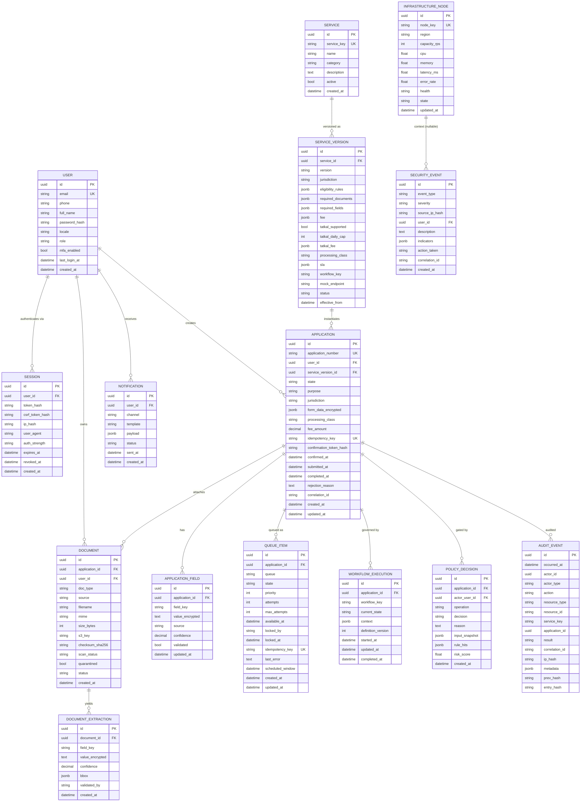

# GovFlow — Database Design (PostgreSQL)

| | |
|---|---|
| **Status** | Approved (Phase 1) |
| **Engine** | PostgreSQL 16 · UUID primary keys · SQLAlchemy 2 async · Alembic migrations |
| **Principle** | **Data minimization** — GovFlow stores the minimum required for the MVP. It is *not* a centralized citizen-record store. |

## 1. Entity-Relationship Diagram

## 2. Design notes

### 2.1 Data minimization (enforced)
- **No Aadhaar/PAN/real identity numbers.** Mock documents use synthetic placeholders (`DEMO-XXXX`); the schema has no column for government identity numbers by design.
- `form_data_encrypted` / `value_encrypted` — application-layer AES-GCM encryption for sensitive values (production: KMS-wrapped data key; dev: key from env).
- `ip_hash` — IPs stored as salted hashes, never raw.
- Retention (MVP defaults): documents 30 days after completion; extractions 30 days; sessions 7 days post-expiry; audit events retained (hash-chained, append-only).

### 2.2 Key constraints & indexes
| Table | Constraint / Index | Purpose |
|---|---|---|
| `applications` | `UNIQUE(idempotency_key)` | Duplicate-submission defense |
| `applications` | `UNIQUE(application_number)` | Human-readable ID `GF-MH-847291` |
| `applications` | `INDEX(user_id, created_at DESC)` | My Applications screen |
| `service_versions` | `UNIQUE(service_id, jurisdiction, version)` | Versioned registry |
| `application_fields` | `UNIQUE(application_id, field_key)` | One value per field |
| `queue_items` | `UNIQUE(idempotency_key)`, `INDEX(state, queue, available_at)` | Claim queries |
| `audit_events` | `prev_hash → entry_hash` chain | Tamper evidence |
| `sessions` | `INDEX(expires_at)` | Cleanup job |

### 2.3 Enumerations (enforced via SQLAlchemy Enum + DB CHECK)
- `role`: `citizen | admin | auditor`
- `auth_strength`: `password | otp_sim | step_up`
- `state` (application/queue): `RECEIVED | VALIDATING | QUEUED | PROCESSING | SUBMITTED | COMPLETED | FAILED | HUMAN_REVIEW`
- `source` (field/document): `ai_extracted | user_entered | verified | digilocker | upload`
- `decision`: `ALLOW | DENY | REQUIRE_CONFIRMATION | REQUIRE_STEP_UP_AUTH | QUEUE`
- `queue`: `realtime | standard | priority | deferred | tatkal`
- `health`: `GREEN | YELLOW | RED`; node `state`: `healthy | slow | overloaded | failed | recovering`
- `action_taken` (security): `logged | blocked | quarantined | isolated | alerted`

### 2.4 Audit hash chain
`entry_hash = SHA-256(prev_hash || canonical_json(event_without_hash_fields))`. A verification job walks the chain; any mismatch raises a critical SecurityEvent. Writes are insert-only (no UPDATE/DELETE grants for the app role).

### 2.5 Migration policy
- All schema changes via Alembic; autogenerate reviewed by hand; no destructive migration without a two-step (deprecate → drop) path.
- Seed data (`scripts/seed.py`): demo user, 3 service versions, infrastructure nodes, sample applications for dashboards.
