# GovFlow — Jenkins CI/CD Architecture

| | |
|---|---|
| **Status** | Approved (Phase 1) · Implementation Phase 18 |
| **Pipeline** | `Jenkinsfile` (declarative) at repo root · shared library in `jenkins/` |
| **Cloud auth** | No static cloud credentials — Jenkins assumes `govflow-ci-deploy` IAM role via OIDC federation (short-lived tokens). Production apply additionally requires the `govflow-prod-approver` role + manual approval stage. |

## 1. Pipeline (main branch)

```mermaid
flowchart LR
    P["Developer push / PR"] --> J["Jenkins webhook"]
    J --> CO["1 Checkout (+ signed-commit check)"]
    CO --> L["2 Lint<br/>(eslint, prettier, ruff, tsc --noEmit)"]
    L --> UT["3 Unit tests<br/>(pytest, vitest) + coverage gate"]
    UT --> SEC["4 Security scans (parallel)<br/>Semgrep SAST · Gitleaks · dep audit · Checkov (tf+k8s)"]
    SEC --> BLD["5 Build (parallel per service)<br/>Docker multi-stage builds"]
    BLD --> SCAN["6 Container scan<br/>Trivy (fail on CRITICAL/HIGH)"]
    SCAN --> PUB["7 Push → AWS ECR<br/>(immutable tags: git SHA + semver)"]
    PUB --> TF["8 Terraform validate + plan<br/>(post plan to PR)"]
    TF --> STD{"env?"}
    STD -->|staging| DEP["9 Deploy staging EKS<br/>(migrate Job → rolling deploy)"]
    DEP --> IT["10 Integration + e2e smoke tests<br/>+ k6 smoke (1K VU)"]
    IT --> APP{"11 Manual approval<br/>(production gate)"}
    APP -->|approved| PRD["12 Deploy production EKS<br/>(same artifact digest)"]
    APP -->|rejected| STOP["Abort + notify"]
    PRD --> VER["13 Post-deploy verification<br/>health, metrics, audit-chain check"]
```

PRs run stages 1–8 (no deploy). Main runs everything. Hotfix path: same pipeline, `production` approval by two approvers.

## 2. Stage details

| Stage | Tools | Gate / failure policy |
|---|---|---|
| Lint | ESLint, Prettier --check, Ruff, `tsc --noEmit`, `terraform fmt -check` | Zero errors |
| Unit tests | pytest (backend/agent/worker/mock), vitest (frontend) | 100% pass; coverage ≥ 80% backend |
| SAST | Semgrep (OWASP + custom ruleset in `jenkins/rules/`) | No new HIGH/CRITICAL |
| Secrets | Gitleaks | Any finding blocks |
| Dependencies | `pip-audit`, `npm audit --omit=dev` | No known CRITICAL |
| IaC | Checkov (terraform + k8s manifests) | No HIGH+ without documented suppression |
| Images | Trivy scan-on-push + pipeline scan | Fail on CRITICAL/HIGH fixable |
| Terraform | `init -backend=false` → `validate` → `plan` (staging/prod var files); plan artifact attached to build | Plan diff reviewed; drift job nightly |
| Deploy | `kubectl` via EKS OIDC role: run Alembic Job → `kubectl apply -k overlays/<env>` → wait rollout | Rollback on failed readiness |
| Post-deploy | Hit `/readyz` on all services, run smoke suite, verify audit hash chain, notify Slack | Failure → auto `kubectl rollout undo` |

## 3. Jenkins infrastructure assumptions

- Jenkins controller hardened, in isolated subnet; **ephemeral agents** (Docker agents) per build — no persistent workspace state.
- Credentials only via Jenkins Credentials Broker: registry pull config, Slack token, OIDC config. **No secrets in Jenkinsfile or repo.**
- Pipeline-as-code: jobs are folder + `Jenkinsfile` from SCM only; no UI-edited job logic (threat model §3.19).
- Build reproducibility: images tagged with git SHA; SBOM (Syft) attached to each build; provenance recorded.

## 4. Environment promotion

| Environment | Trigger | Approval | Notes |
|---|---|---|---|
| staging | merge to `main` | automatic | Full WAF/monitoring; mocks only |
| production | manual approval stage (named approvers) | 1 approver (2 for hotfix) | Same digest as staging-tested build; Terraform apply uses approver OIDC role |

## 5. Quality gates recap (spec §36)

Linting ✅ · unit ✅ · integration ✅ · dependency scanning ✅ · SAST ✅ · secret scanning ✅ · image scanning ✅ · Terraform scanning ✅ · Kubernetes manifest scanning ✅ — all open-source tooling (Semgrep, Trivy, Gitleaks, Checkov, pip-audit/npm audit).
