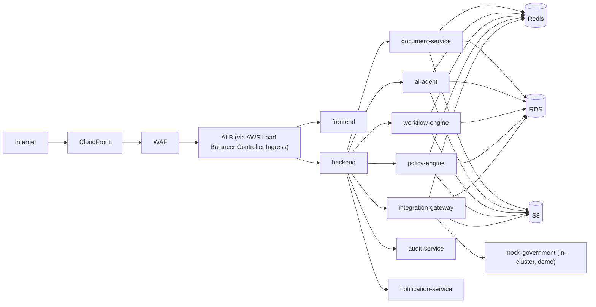

# GovFlow — Kubernetes (EKS) Architecture Plan

| | |
|---|---|
| **Status** | Approved (Phase 1) · Implementation Phase 17 |
| **Cluster** | Amazon EKS, private API endpoint, managed node groups (`general` on-demand, `workers` spot-tolerant), 3 AZs |
| **Layout** | `kubernetes/` plain manifests (Kustomize-compatible) — Helm optional later |

## 1. Namespaces

| Namespace | Contents |
|---|---|
| `govflow` | All 10 application services |
| `govflow-system` | Ingress controller (AWS LBC), External Secrets Operator, Metrics Server |
| `monitoring` | Prometheus, Grafana (compose-parity for staging) |

## 2. Workloads (10 logical services)

| Deployment | Image / entrypoint | Replicas (staging) | Probes (readiness/liveness) | HPA target |
|---|---|---|---|---|
| `frontend` | frontend (Next.js standalone) | 2 | HTTP `/` 200 | CPU 70% |
| `backend` | backend uvicorn `api` entrypoint | 3 | `/readyz` · `/healthz` | CPU 65% + RPS |
| `workflow-engine` | backend image, entrypoint `workflow` | 2 | `/readyz` (workflow-scoped) | CPU 65% |
| `policy-engine` | backend image, entrypoint `policy` | 2 | `/readyz` | CPU 65% |
| `integration-gateway` | backend image, entrypoint `integration` | 2 | `/readyz` | CPU 60% |
| `ai-agent` | ai-agent | 2 | `/readyz` | CPU 65% (LLM latency-aware) |
| `document-service` | document-service | 2 | `/readyz` | **Queue depth + CPU** |
| `queue-worker` | worker (all queues; deferred/tatkal via separate Deployments if load demands) | 3 | liveness + queue-heartbeat | **Queue lag** |
| `notification-service` | backend image, entrypoint `notifications` | 1–2 | `/readyz` | CPU 60% |
| `audit-service` | backend image, entrypoint `audit` | 2 | `/readyz` | CPU 60% |
| `mock-government` | mock-government | 1 (demo) | `/readyz` | none |

> The five module-based services share the backend image with different entrypoints (ADR-001) — already separate Deployments, Services, ServiceAccounts, and HPAs, so splitting images later requires no manifest restructuring.

**Every Deployment:** `resources.requests/limits` set (no BestEffort/Burstable surprises), `securityContext` (runAsNonRoot, readOnlyRootFilesystem, drop ALL capabilities, seccomp RuntimeDefault), `topologySpreadConstraints` across AZs, rolling update `maxUnavailable: 0`, ServiceAccount per service (IRSA/Pod Identity scoped IAM).

## 3. Probes, PDBs, HPAs

- **Readiness** gates traffic (DB/Redis/dependency checks); **liveness** restarts wedged pods; startup probes for slower services (document-service OCR init).
- **PodDisruptionBudget:** `minAvailable: 1` for single-replica services; `minAvailable: 50%` for 2+ replicas — voluntary disruptions (node upgrades, spot reclaim) never take all replicas.
- **HPA:** CPU/memory default; custom metrics (`queue_depth`, `ocr_backlog`, `p95_latency`) via Prometheus Adapter for worker/document/ai-agent; `behavior.scaleDown` stabilized (no flapping during spike demo).

## 4. Networking & zero-trust

**NetworkPolicies (default-deny + explicit allow):**
- `default-deny-all` in `govflow` (ingress + egress).
- frontend → backend only; backend → module services; ai-agent → backend only (**no DNS-excepted external egress, no internet** — prompt-injection egress denial at network layer); workers → Redis/RDS/backend; document-service → S3 (via VPC endpoint) + backend.
- Data plane (RDS/ElastiCache) reachable only from app pods via SG references; VPC endpoints for S3/ECR/Secrets Manager (no NAT for AWS traffic).

## 5. Config, secrets, jobs

| Concern | Approach |
|---|---|
| Non-sensitive config | ConfigMaps per service (`GF_LOG_LEVEL`, feature flags, queue names, simulator settings) |
| Secrets | **External Secrets Operator → AWS Secrets Manager** (`govflow/<env>/<service>`); `kubernetes/secrets/` contains only dev-example templates, never real values |
| DB migrations | K8s `Job` (`alembic upgrade head`) as a pre-deploy hook step in pipeline; never auto-run in app startup |
| Demo seed | `kubernetes/jobs/seed-demo.yaml` Job (idempotent, synthetic data) |
| Ingress | Single Ingress via AWS LBC → ALB; internal services are ClusterIP only; `/api/v1/admin` path additionally restricted by WAF IP rule |
| Pod Security | Namespace labels enforce **restricted** Pod Security Standard |

## 6. Resilience behaviors demonstrated

- Pod kill → Deployment recreates (liveness + ReplicaSet) — queue items locked by dead worker expire via visibility timeout and are re-delivered (test #8).
- AZ disruption → topology spread + PDB keep capacity.
- Spike → HPA on queue lag scales workers; ALB target-group metrics feed autoscaling; nothing dropped (Postgres source-of-truth + reconciler).
- Rolling deploy → `maxUnavailable: 0`, readiness-gated; failed deploy auto-rolls back (`deployment.controller.revisionHistoryLimit` + pipeline rollback stage).
