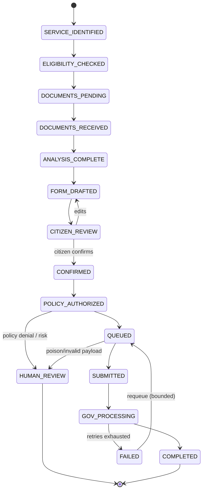

# GovFlow — Service Registry & Workflow Definitions (MVP)

| | |
|---|---|
| **Status** | Approved (Phase 1) |
| **Principle** | All service logic lives here (seeded into the versioned Service Registry DB tables). **No government logic is hardcoded in AI prompts or agent code.** Adding a service = adding a registry definition. |

## 1. Shared workflow state machine

All three services use the same canonical workflow (`workflow_key: application_v1`); service versions may customize steps via flags (e.g., tatkal).



**Transition rules (engine-enforced):**
- `CONFIRMED` requires a valid confirmation artifact: `SHA-256(reviewed payload) == hash bound to confirmation_token`, session `auth_strength >= otp_sim`, and policy decision `ALLOW`.
- `QUEUED → SUBMITTED` is idempotent (keyed by `application.idempotency_key`); integration gateway retries with exponential backoff; circuit breaker state respected.
- Any transition emits `AUDIT_EVENT` with correlation ID.
- AI can *request* transitions via tools; only the engine executes them.

## 2. Service definitions (registry seeds)

### 2.1 Income Certificate — `income_certificate` v1.0 (Maharashtra)

```yaml
service_key: income_certificate
name: Income Certificate
jurisdiction: MH
version: "1.0"
category: certificates
description: >
  Certifies the annual income of an applicant/household for education,
  scholarship, subsidy and legal purposes (state of Maharashtra).
description_i18n:
  hi: "शिक्षा, छात्रवृत्ति और अन्य उद्देश्यों के लिए वार्षिक आय प्रमाण पत्र।"
  mr: "शिक्षण, शिष्यवृत्ती व इतर हेतूंसाठी वार्षिक उत्पन्न प्रमाणपत्र."
processing_class: normal
tatkal_supported: false
fee: { currency: INR, amount: 50 }
sla: { normal_days: 15 }
required_documents: [identity, address_proof, income_proof]
optional_documents: [old_income_certificate]
required_fields:
  - { key: full_name,      type: string,  min: 3, max: 120, source: any, i18n_label: { en: "Full name", hi: "पूरा नाम", mr: "संपूर्ण नाव" } }
  - { key: date_of_birth,  type: date,    min_age: 0, max_age: 120, source: any }
  - { key: address,        type: string,  min: 10, max: 300, source: any }
  - { key: district,       type: enum,    values: [latur, pune, mumbai_city, mumbai_suburban, nagar, nagpur, nashik], source: any }
  - { key: annual_income,  type: currency, currency: INR, min: 0, max: 10000000, source: income_proof|user }
  - { key: income_source,  type: enum,    values: [salary, agriculture, business, other], source: user }
  - { key: purpose,        type: enum,    values: [education, employment, subsidy, legal, other], source: user }
  - { key: ration_card_no, type: string,  required: false, synthetic_only: true }
eligibility_rules:
  - { id: resident_mh,        expr: "state == 'MH'",                      failure_msg: "Service available only for Maharashtra residents." }
  - { id: income_ceiling,     expr: "annual_income <= 800000",            failure_msg: "Income above ₹8,00,000 is not eligible for this certificate." }
  - { id: purpose_supported,  expr: "purpose in ['education','employment','subsidy','legal','other']" }
workflow: application_v1
mock_endpoint: /mock/umang/income
```

### 2.2 Birth Certificate — `birth_certificate` v1.0 (Maharashtra)

```yaml
service_key: birth_certificate
name: Birth Certificate
jurisdiction: MH
version: "1.0"
category: certificates
description: Registration/certified copy of a birth record registered in Maharashtra (applicant, or parent/guardian for a child).
processing_class: normal
tatkal_supported: true
tatkal_daily_cap: 5000          # limited capacity; never "pay to bypass" — reserved slice only
fee: { currency: INR, amount: 30 }
tatkal_fee: { currency: INR, amount: 150 }
sla: { normal_days: 7, tatkal_hours: 24 }
required_documents: [identity, birth_proof]
optional_documents: [address_proof, hospital_record]
required_fields:
  - { key: child_full_name,   type: string, min: 3, max: 120 }
  - { key: date_of_birth,     type: date,   must_be_past: true, max_age: 120 }
  - { key: place_of_birth,    type: string, min: 3, max: 200 }
  - { key: gender,            type: enum,   values: [male, female, other] }
  - { key: father_name,       type: string, min: 3, max: 120 }
  - { key: mother_name,       type: string, min: 3, max: 120 }
  - { key: registration_no,   type: string, required: false, synthetic_only: true }
  - { key: applicant_relation, type: enum,  values: [self, parent, guardian] }
eligibility_rules:
  - { id: resident_mh,   expr: "state == 'MH'" }
  - { id: dob_past,      expr: "date_of_birth < today" }
  - { id: relation,      expr: "applicant_relation in ['self','parent','guardian']", failure_msg: "Only the person, a parent, or a legal guardian may apply." }
workflow: application_v1
mock_endpoint: /mock/umang/birth
```

### 2.3 Driving Licence — `driving_licence` v1.0 (Maharashtra)

```yaml
service_key: driving_licence
name: Driving Licence
jurisdiction: MH
version: "1.0"
category: transport
description: Apply for a new driving licence or renew an existing one (mock of Sarathi-style flow, Maharashtra).
processing_class: normal
tatkal_supported: true
tatkal_daily_cap: 5000
fee: { currency: INR, amount: 200 }
tatkal_fee: { currency: INR, amount: 500 }
sla: { normal_days: 30, tatkal_days: 5 }
required_documents: [identity, address_proof, age_proof, photo]
optional_documents: [medical_certificate, existing_licence]
required_fields:
  - { key: full_name,          type: string, min: 3, max: 120 }
  - { key: date_of_birth,      type: date }
  - { key: licence_action,     type: enum, values: [new, renewal] }
  - { key: vehicle_class,      type: enum, values: [LMV, MCWG, MCWOG, TRANS] }
  - { key: blood_group,        type: enum, values: [A, B, AB, O, unknown], required: false }
  - { key: address,            type: string, min: 10, max: 300 }
  - { key: existing_licence_no, type: string, required_if: "licence_action == 'renewal'", synthetic_only: true }
eligibility_rules:
  - { id: resident_mh,  expr: "state == 'MH'" }
  - { id: min_age_lmv,  expr: "age >= 18", failure_msg: "Applicant must be at least 18 years old for LMV." }
  - { id: min_age_mcwg, expr: "not (vehicle_class in ['MCWG','MCWOG'] and age < 16)" }
  - { id: renewal_has_licence, expr: "licence_action != 'renewal' or existing_licence_no present" }
workflow: application_v1
mock_endpoint: /mock/umang/driving
```

## 3. Document type catalog (shared)

| doc_type | Accepted sources | Mock DigiLocker names | Notes |
|---|---|---|---|
| `identity` | upload, digilocker | "Identity Card (Demo)" | Synthetic values only |
| `address_proof` | upload, digilocker | "Address Proof (Demo)" | |
| `income_proof` | upload, digilocker | "Income Record (Demo)" | Feeds `annual_income` extraction |
| `birth_proof` | upload, digilocker | "Birth Record (Demo)" | Feeds birth fields |
| `age_proof` | upload, digilocker | "Age Proof (Demo)" | Driving licence |
| `photo` | upload | — | Passport photo |
| `medical_certificate`, `existing_licence`, `hospital_record`, `old_income_certificate` | upload | — | Optional |

Accepted files: PDF/PNG/JPG ≤ 10 MB. Every document passes the pipeline: MIME sniff → size cap → malware scan → quarantine-on-suspicion → sandboxed OCR → extraction → validation.

## 4. Processing classes & queues

| Class | Queue | Trigger | Rules |
|---|---|---|---|
| STANDARD | `standard` | Default | Normal SLA |
| PRIORITY | `priority` | Government-defined eligibility (e.g., education purpose in admission season — demo flag) | Higher consumer weight |
| DEFERRED | `deferred` | Citizen opts in ("flexible, cheaper ETA not needed") | Released in off-peak windows on the smoothing curve |
| TATKAL | `tatkal` | Citizen pays tatkal fee, service supports it | **Daily cap enforced** (5,000); when exhausted → policy returns "Tatkal capacity is currently full" with standard/priority/deferred options; reserved capacity slice — never preempts other queues |

## 5. Registry evolution policy

- Definitions are **versioned**; running applications stay pinned to their `service_version_id`.
- New jurisdiction or field change → new version (e.g., `1.1`), never in-place mutation of an active version.
- The AI agent reads requirements/eligibility/fees **only** through registry tools (`get_service_requirements`, `check_eligibility`) — adding service #4 requires zero prompt changes.
