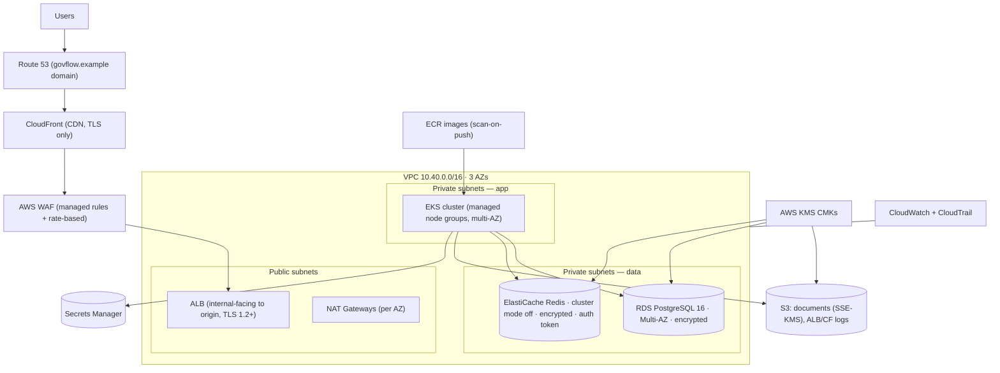

# GovFlow — Terraform (AWS) Architecture Plan

| | |
|---|---|
| **Status** | Approved (Phase 1) · Implementation Phase 15 |
| **Terraform** | >= 1.10 · remote state in S3 with **native state locking** (`use_lockfile`, KMS-encrypted bucket; DynamoDB lock table only as legacy fallback) |
| **Rule** | No hardcoded account IDs, ARNs, secrets, or credentials. Everything via variables + data sources. |

## 1. Topology



## 2. Module layout

```
terraform/
├── modules/
│   ├── networking/    # VPC, subnets (public/private/data × 3 AZ), IGW, NAT, route tables, flow logs
│   ├── eks/           # EKS control plane, managed node groups (2 sizes), add-ons (VPC-CNI, EBS CSI,
│   │                  #   Metrics Server, External Secrets via helm_release), IRSA roles, OIDC provider
│   ├── rds/           # PostgreSQL 16 Multi-AZ, credentials in Secrets Manager, KMS, backup window,
│   │                  #   deletion protection (prod), enhanced monitoring, security group (EKS SG only)
│   ├── redis/         # ElastiCache Redis, subnet group (data subnets), auth token in Secrets Manager,
│   │                  #   encryption in transit/at rest
│   ├── s3/            # Documents bucket (SSE-KMS, versioning, lifecycle→IA, block-public-access),
│   │                  #   logs bucket (CloudFront/ALB), Terraform state bucket (separate)
│   ├── ecr/           # Repos per deployable, scan-on-push, immutable tags, lifecycle policies
│   ├── iam/           # Least-privilege roles: IRSA per K8s service account, CI deploy role (OIDC-federated),
│   │                  #   break-glass role; NO AdministratorAccess for workloads
│   ├── monitoring/    # CloudWatch log groups, alarms (5xx, latency, queue age, RDS/Redis), SNS topic,
│   │                  #   CloudTrail trail (multi-region, KMS-encrypted)
│   └── waf/           # WAF WebACL: managed rule groups (Core, KnownBadInputs, IPReputation),
│                      #   rate-based rules, geo constraints, CloudFront + ALB associations
└── environments/
    ├── dev/           # Single-NAT cost-optimized, spot node group, 1×RDS (no Multi-AZ)
    ├── staging/       # Prod-like, smaller sizes, full WAF + monitoring
    └── production/    # Multi-AZ everything, deletion protection, retention policies, manual apply
```

## 3. Key design decisions

| Area | Decision |
|---|---|
| **State** | S3 remote state, KMS-encrypted, versioned bucket, native locking (`use_lockfile = true`); separate state per environment; no shared state |
| **Networking** | /16 VPC; public /24, private-app /22, private-data /24 per AZ; DB/Redis **never public**; no IGW route on data subnets; restrictive NACLs + SG least privilege (SG-to-SG references only) |
| **EKS** | Private API endpoint (+ admin CIDR allowlist); managed node groups: `general` (on-demand, apps) and `workers` (spot-tolerant, queue workers); labels/taints for workload placement; Pod Identity / IRSA per service account |
| **RDS** | Credentials auto-generated → Secrets Manager; app reads via External Secrets Operator; `performance_insights`, 7–35 day backups by env; no public accessibility |
| **ElastiCache** | TLS + auth token; private subnets; SG allows only EKS workers SG on 6379 |
| **S3** | Documents bucket KMS CMK with per-key policy; presigned-URL uploads from backend only; Object Lock optional for quarantine bucket |
| **Secrets** | AWS Secrets Manager is source of truth; K8s consumes via External Secrets Operator; **no secrets in tfvars, git, AMIs, or images**; example files only (`*.tfvars.example`) |
| **CI/CD IAM** | Jenkins assumes `govflow-ci-deploy` role via GitHub/Jenkins OIDC federation; scoped to ECR push, EKS describe/update, S3 state; prod apply requires separate `govflow-prod-approver` role + manual approval stage |
| **WAF** | Rate-based rule (2,000/5min/IP), AWS managed core + known-bad-inputs + bot control (staging/prod), custom rules for `/api/v1/admin` (IP set) |
| **Observability** | VPC flow logs → S3; ALB/CF logs → S3; CloudTrail multi-region; alarms → SNS email + Slack webhook (via Secrets Manager) |

## 4. Environment matrix

| | dev | staging | production |
|---|---|---|---|
| AZs | 2 | 3 | 3 |
| Node groups | 1× spot t3.medium ×2 | general 3× m6i.large + workers 2× | general 3+× m6i.xlarge + workers 3+× (HPA/cluster autoscaler) |
| RDS | db.t4g.medium single-AZ | db.m6g.large Multi-AZ | db.m6g.large Multi-AZ + read replica |
| ElastiCache | cache.t4g.micro | cache.m6g.large | cache.m6g.large ×2 shards |
| WAF | core rules | full | full + bot control |
| Deletion protection | off | off | on |
| Apply mode | pipeline auto | pipeline auto | pipeline plan → **manual approval** → apply |

## 5. Provisioning flow

1. `bootstrap/` (one-time, documented in scripts/): create state bucket + KMS key + lock config.
2. `environments/dev` → `init && plan && apply` (pipeline or local with CI role).
3. Outputs (VPC IDs, EKS name, ECR URLs, Secrets paths) consumed by k8s deploy stage and External Secrets manifests.
4. `checkov`/`tfsec` scan gate on every plan; `infracost` optional budget check.
5. Drift detection: nightly `plan -detailed-exitcode` job → alarm on drift.

## 6. Cost & scale guardrails (MVP honesty)

- MVP load validation happens in **staging** against mocks; production sizing above is a *starting point*, not a claim of national-scale readiness (per spec §48).
- Dev environment teardown script (`scripts/terraform-destroy-dev.sh`) for cost hygiene; NAT gateway count reduced in dev.
